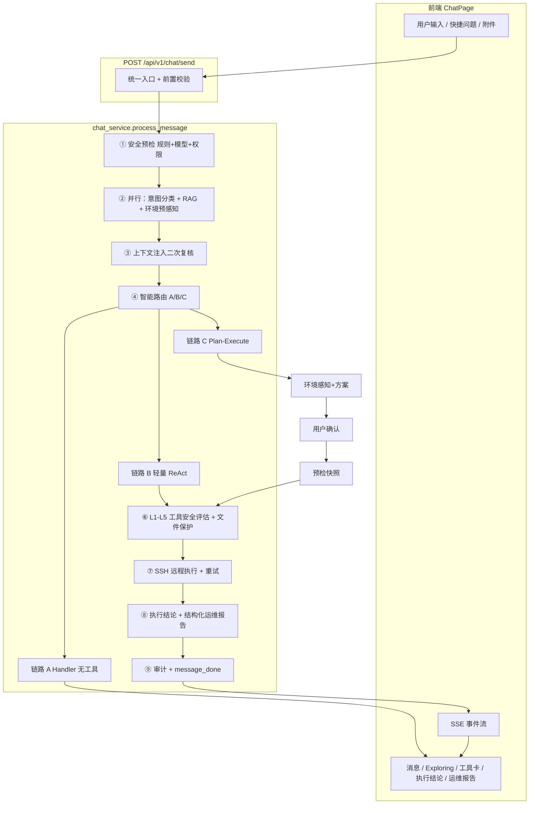

# KylinOps Agent 工作流程总览（优化版）

本文档描述 **从用户发消息到 Agent 回复** 的端到端流程，对应三条独立链路的智能路由架构。

---

## 1. 整体链路总览

```
前端交互 → API 接口 → 全链路安全防护 → 意图+知识融合 → 智能路由 →
[链路 A 普通问答 / 链路 B 轻量 ReAct / 链路 C Plan-Execute] →
结果汇总与审计 → 前端渲染 → 用户反馈 → 知识库迭代
```



---

## 2. 三条链路定义

| 链路 | 代码标识 | 匹配条件 | 行为 |
|------|----------|----------|------|
| **A 普通问答** | `link_a` | `general_qa` / `knowledge_qa` | Handler 纯 LLM，禁止工具 |
| **B 轻量 ReAct** | `link_b` | `ops_query` 且置信度≥0.9 且只读查询 | 跳过方案确认，直接 ReAct |
| **C Plan-Execute** | `link_c` | `fault_analysis` / `high_risk` / 低置信 ops_query / 服务启停 / 磁盘清理 | 环境感知→方案→确认→分步执行 |

路由模块：`backend/app/services/agent/chains.py` → `dispatch_chain()`（封装 `agent_workflow.resolve_workflow_link()`）

---

## 2.1 八阶段实施模块

| 阶段 | 模块 | 路径 |
|------|------|------|
| 1 基础状态 | 状态机 + 意图 | `services/agent/state_machine.py`、`langgraph_agent/state.py` |
| 2 三路分流 | 链路分发 | `services/agent/chains.py`、`langgraph_agent/graph.py` |
| 3 链路 B | 轻量 ReAct | `nodes_supervision.chain_b_tool_safety_node` |
| 4 快照/回滚 | 安全基础设施 | `services/agent/snapshot_manager.py`、`rollback_manager.py`、`file_protection.py` |
| 5 链路 C | Plan-Execute | `human_supervision.py`、`DiagnosticPlanCard.vue` |
| 6 断点续传 | Checkpoint API | `services/agent/checkpoint_manager.py`、`api/routes/chat.py` |
| 7 反馈闭环 | 知识迭代 | `services/agent/feedback_loop.py`、`knowledge_cycle.py` |
| 8 集成 | 主流程 | `chat_service.py`、`langgraph_agent/service.py` |

---

## 3. L1-L5 风险等级

| 等级 | 定义 | 处理逻辑 |
|------|------|----------|
| L1 | 只读操作 | 自动放行 |
| L2 | 低风险修改 | 前端 L2 确认卡片 |
| L3 | 中风险操作 | 用户确认 + 审计记录 |
| L4 | 高风险操作 | 管理员审批 → 用户确认执行 |
| L5 | 极高风险 | 直接拦截 |

文件保护：`command_security._check_path_protections()` + `agent_workflow.build_file_protection_whitelist()`

---

## 4. Plan-Execute 链路（链路 C）步骤

1. **深度环境感知**：`environment_sensor.sense()` + 文件保护白名单
2. **方案生成**：`build_diagnostic_plan()` + `enrich_diagnostic_plan_with_env()`
3. **用户确认**：`diagnostic_plan` SSE → `awaiting_plan_confirm`
4. **预执行准备**：`run_env_precheck()` 逻辑快照
5. **原子化分步执行**：ReAct + L1-L5 门禁 + `resume_after_approval`
6. **结果验证与回滚**：`rollback_engine` / `run_session_rollback`
7. **结构化报告**：`ops_report` SSE + 用户反馈 `TraceOutcome`

---

## 5. 统一任务状态

定义于 `agent_workflow.AgentTaskStatus`：

`pending` → `routing` → `awaiting_plan_confirm` → `env_precheck` → `executing` →
`awaiting_confirm` / `awaiting_approval` → `summarizing` → `completed` / `failed` / `cancelled`

---

## 6. 主要 SSE 事件

| 事件 | 说明 |
|------|------|
| `route_dispatch` | 链路分流结果（link_a/b/c） |
| `diagnostic_plan` | Plan-Execute 方案卡片 |
| `env_precheck` | 预执行环境检查结果 |
| `task_progress` | 任务编排器阶段进度 |
| `need_confirm` / `need_approval` | L2/L4 人工环节 |
| `ops_report` | 结构化运维报告 |
| `message_done` | 流结束 + 状态 |

---

## 7. 关键代码入口

| 模块 | 路径 |
|------|------|
| 工作流路由 | `services/agent_workflow.py` |
| Agent 主流程 | `services/chat_service.py` |
| 人类监督 | `services/human_supervision.py` |
| 环境感知 | `services/environment_sensor.py` |
| 命令安全 | `core/command_security.py` |
| 任务编排 | `services/task_orchestrator.py` |
| 回滚引擎 | `services/rollback_engine.py` |
| 用户反馈 | `api/routes/trace_outcome.py` |

---

## 8. 配置项

| 配置 | 默认 | 说明 |
|------|------|------|
| `max_user_input_length` | 8192 | 输入长度上限 |
| `workflow_lightweight_confidence` | 0.9 | 链路 B 阈值 |
| `workflow_plan_confidence` | 0.7 | 低于此值 ops_query 走链路 C |
| `command_max_retries` | 2 | 命令失败重试次数 |
| `enable_diagnostic_plan` | true | 是否启用 Plan-Execute |
