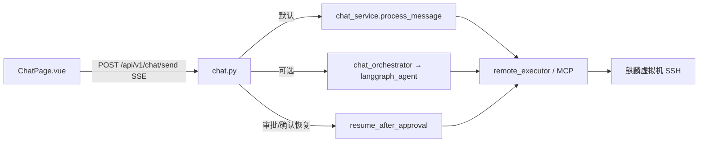
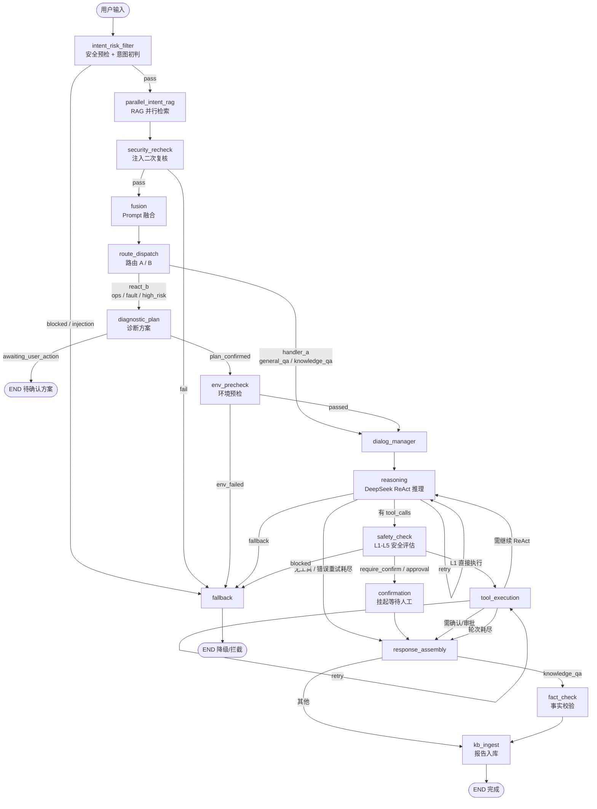
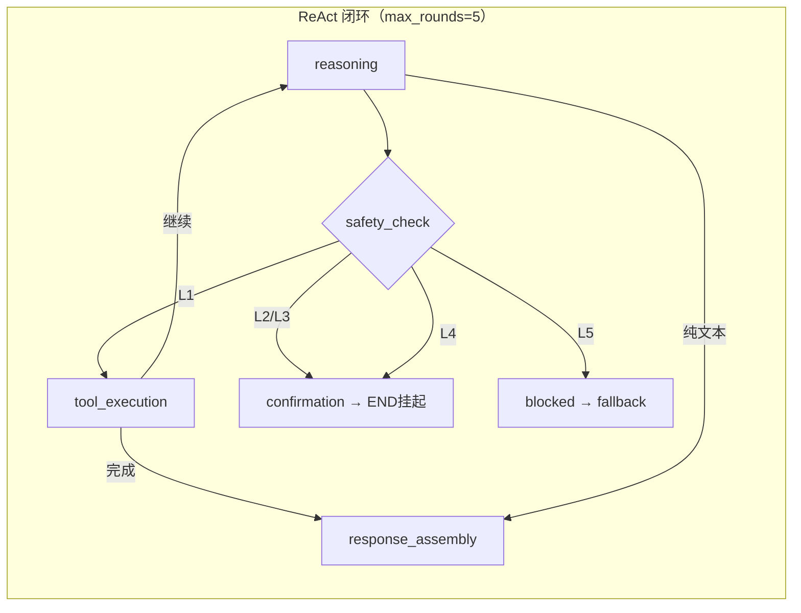
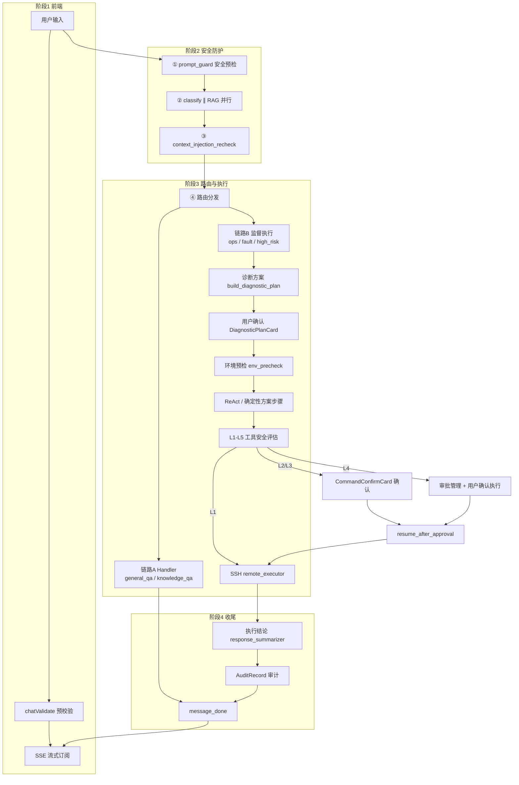
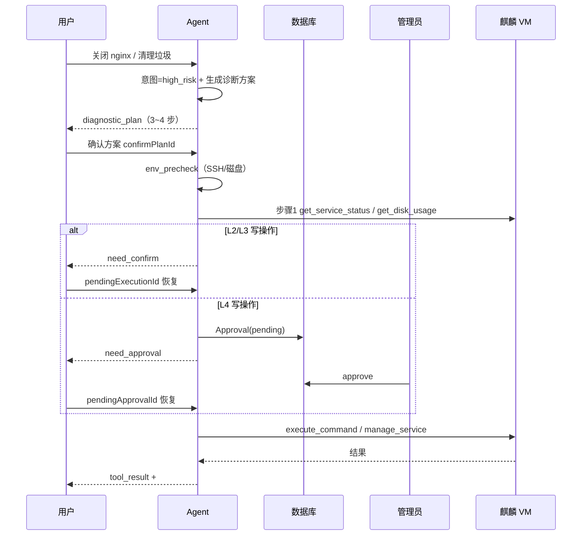
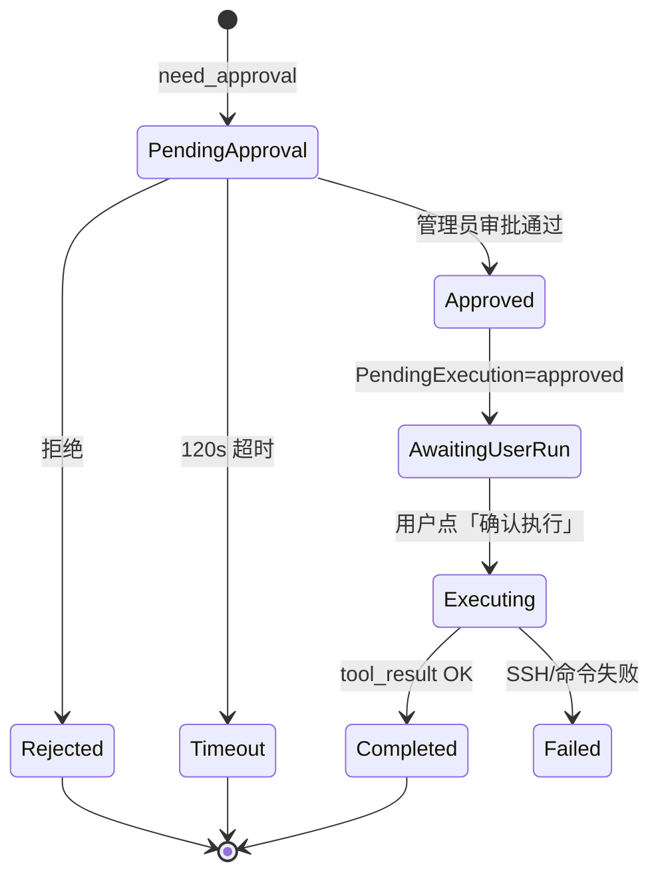

# KylinOps Agent — LangGraph 架构、工作流与技能全景

> 代码入口：`backend/app/langgraph_agent/`（LangGraph 图）  
> 生产默认路径：`backend/app/services/chat_service.py`（`use_langgraph_orchestrator=False`）  
> 切换 LangGraph：环境变量 `USE_LANGGRAPH_ORCHESTRATOR=true`

---

## 1. 双运行时架构



| 运行时 | 配置 | 特点 |
|--------|------|------|
| **chat_service**（默认） | `use_langgraph_orchestrator=False` | 功能最完整：诊断方案确定性执行、审批恢复、SSE 事件齐全 |
| **LangGraph**（可选） | `use_langgraph_orchestrator=True` | 图编排、MemorySaver 检查点、节点化阶段 |
| **resume_after_approval** | 两条路径共用 | `pendingApprovalId` / `pendingExecutionId` 恢复挂起工具 |

---

## 2. LangGraph 状态图（完整拓扑）

对应文件：`backend/app/langgraph_agent/graph.py`



### 2.1 节点清单（16 个）

| 节点 ID | 模块文件 | 职责 |
|---------|----------|------|
| `intent_risk_filter` | `nodes.py` | `prompt_guard` + `intent_classifier`，注入/拦截 |
| `parallel_intent_rag` | `nodes.py` | 知识库 RAG 检索（BM25+TF-IDF） |
| `security_recheck` | `nodes_supervision.py` | `context_injection_recheck` 上下文复核 |
| `fusion` | `nodes.py` | SYSTEM_PROMPT + 意图 + RAG + 会话记忆 → messages |
| `route_dispatch` | `nodes_supervision.py` | 链路 A（Handler）/ 链路 B（ReAct+方案） |
| `diagnostic_plan` | `nodes_supervision.py` | `build_diagnostic_plan`，等待用户确认 |
| `env_precheck` | `nodes_supervision.py` | SSH 连通、磁盘、逻辑快照 |
| `dialog_manager` | `nodes.py` | 对话历史整理，进入 ReAct |
| `reasoning` | `nodes.py` | DeepSeek 流式推理 + tool_calls 解析 |
| `safety_check` | `nodes.py` | `command_security` L1–L5 分级 |
| `confirmation` | `nodes.py` | L2/L3 确认、L4 审批挂起 |
| `tool_execution` | `nodes.py` | MCP/SSH 远程执行 |
| `response_assembly` | `nodes.py` | 组装最终回复、运维报告 |
| `fact_check` | `nodes_supervision.py` | 知识问答防幻觉校验 |
| `kb_ingest` | `nodes_supervision.py` | 结构化报告写入知识库草稿 |
| `fallback` | `nodes.py` | 降级/拦截响应 |

### 2.2 ReAct 循环子图



### 2.3 AgentState 核心字段

定义于 `backend/app/langgraph_agent/state.py`

| 分组 | 字段 | 说明 |
|------|------|------|
| 输入 | `user_input`, `session_id`, `trace_id`, `confirm_plan_id` | 用户消息与会话 |
| 意图 | `intent`, `intent_confidence`, `is_injection`, `blocked` | 分类与安全 |
| RAG | `rag_context`, `rag_sources` | 知识库检索结果 |
| ReAct | `messages`, `round_count`, `tool_calls`, `reasoning_steps` | LLM 上下文与工具 |
| 安全 | `require_approval`, `require_confirm`, `approval_id` | 人工监督 |
| 监督 | `diagnostic_plan`, `plan_confirmed`, `env_precheck`, `ops_report` | 人类监督流程 |
| 输出 | `final_response`, `state_cards`, `final_status` | SSE 推送 |

---

## 3. 生产默认工作流（chat_service）

当前线上默认走此路径（与 LangGraph 逻辑对齐，实现更完整）。



---

## 4. 全部工作流清单

### 4.1 意图路由工作流

| 意图 | 值 | 路由 | 行为 |
|------|-----|------|------|
| 普通问答 | `general_qa` | 链路 A | 纯 LLM，无 SSH |
| 知识查询 | `knowledge_qa` | 链路 A | RAG + LLM，禁止工具 |
| 运维查询 | `ops_query` | 链路 B | ReAct 只读工具为主 |
| 故障分析 | `fault_analysis` | 链路 B | 多步诊断 + 方案 + ReAct |
| 高风险操作 | `high_risk` | 链路 B | 方案确认 + L4 审批链 |
| 注入拦截 | `prompt_injection` | 终止 | `prompt_injection_detected` |

**特殊守卫**（`ops_scope.py`）：

- 服务启停（`is_service_control_request`）→ 强制 `high_risk`
- 磁盘清理执行（`is_disk_cleanup_execution_request`）→ 强制 ReAct + 分级确认

### 4.2 人类监督分阶段工作流（阶段 1–5）

| 阶段 | 名称 | 关键模块 | SSE 事件 |
|------|------|----------|----------|
| 1 | 前端发起 | `ChatPage`, `chatValidate` | — |
| 2 | 全链路安全 | `prompt_guard`, `intent_classifier`, `context_injection_recheck` | `exploring_step`, `intent`, `risk_notice` |
| 3 | 路由执行 | `build_diagnostic_plan`, `human_supervision`, ReAct | `diagnostic_plan`, `env_precheck`, `tool_call` |
| 3b | L2 确认 | `PendingExecution` | `need_confirm` |
| 3c | L4 审批 | `Approval` + `PendingExecution` | `need_approval` |
| 3d | 审批恢复 | `resume_after_approval` | `tool_call`, `tool_result`, `summary_*` |
| 4 | 审计收尾 | `AuditRecord`, `TraceTelemetry` | `message_done` |
| 5 | 用户反馈 | `TraceFeedbackBar`, `trace-outcome` | — |

### 4.3 诊断方案工作流（链路 B 典型：关 nginx / 清磁盘）



**预置方案模板**（`human_supervision.build_diagnostic_plan`）：

| 场景 | 步骤 |
|------|------|
| 服务控制 | 查状态(L1) → stop/start/restart(L4) → 验证(L1) |
| 磁盘清理 | 查磁盘(L1) → dnf clean(L2) → journalctl vacuum(L3) → 再查(L1) |
| 故障分析 | 确认现象 → 查服务/资源 → 查日志 → 修复建议 |

### 4.4 L4 审批 + 用户确认执行（两段式人工）



> 注意：**审批通过 ≠ 自动执行**。必须在对话页点击「确认执行」才会调用 `resume_after_approval`。

### 4.5 命令风险处置工作流

| 等级 | 含义 | 典型命令/工具 | 系统行为 |
|------|------|---------------|----------|
| **L1** | 只读安全 | `get_disk_usage`, `get_service_status` | 直接 SSH 执行 |
| **L2** | 低风险可逆 | `kill -TERM`, `dnf clean all` | 聊天页确认框 |
| **L3** | 中风险 | `journalctl --vacuum` | 确认或策略提示 |
| **L4** | 高危 | `systemctl stop`, `manage_service stop` | 管理员审批 → 用户确认 |
| **L5** | 禁止 | `rm -rf /`, 黑名单模式 | `blocked`，不执行 |

安全引擎 5 层检测（`command_security.py`）：分组匹配 → 黑名单 → 参数风险 → 绕过检测 → 路径保护。

---

## 5. Agent 技能（Tools / MCP）

定义于 `backend/app/services/tool_definitions.py`，经 `remote_executor` / MCP 在目标 VM 执行。

### 5.1 感知类（只读 · 通常 L1）

| 技能名 | 功能 | 典型场景 |
|--------|------|----------|
| `get_system_info` | CPU/内存/磁盘/系统版本概览 | 巡检、环境摸底 |
| `get_disk_usage` | 磁盘挂载与使用率 | 磁盘满排查、清理前后对比 |
| `get_cpu_info` | CPU 使用率、负载 | 性能分析 |
| `get_memory_info` | 内存与 Swap | 内存泄漏排查 |
| `list_processes` | 进程列表（按 CPU/内存排序） | 找高占用进程 |
| `get_process_detail` | 单进程详情 | 进程异常分析 |
| `get_network_connections` | 网络连接/监听端口 | 网络故障 |
| `get_service_status` | systemd 服务状态 | 服务健康检查 |
| `get_file_list` | 目录文件列表 | 路径排查 |
| `read_file` | 读取文件内容 | 配置/日志查看 |
| `search_journal_logs` | journal 日志检索 | 故障定位 |
| `get_users` | 系统用户列表 | 账号审计 |
| `get_groups` | 用户组列表 | 权限审计 |

### 5.2 操作类（写操作 · L2–L4）

| 技能名 | 功能 | 默认风险 | 典型场景 |
|--------|------|----------|----------|
| `kill_process` | 终止进程（TERM/KILL） | L2–L3 | 杀僵死进程 |
| `manage_service` | start/stop/restart/reload 服务 | stop=L4 | 关闭 nginx 等 |
| `execute_command` | 执行任意 shell（受安全引擎约束） | 按命令分级 | dnf clean、journalctl vacuum |

### 5.3 编排类

| 技能名 | 功能 | 说明 |
|--------|------|------|
| `summarize_task` | 任务总结标记 | ReAct 循环结束信号 |

### 5.4 场景技能包（业务层组合，非独立 Tool）

由 `build_diagnostic_plan` + 确定性步骤 `_stream_planned_diagnostic_execution` 编排：

| 场景技能 | 触发关键词 | 步骤链 |
|----------|------------|--------|
| **磁盘清理** | 清理垃圾、释放空间、dnf clean | 查磁盘 → dnf clean(L2) → journal vacuum(L3) → 验证 |
| **服务控制** | 关闭/启动/重启 nginx 等 | 查状态 → systemctl 操作(L4) → 验证 |
| **故障诊断** | 故障、异常、排查 | 现象确认 → 资源/服务 → 日志 → 修复建议 |

---

## 6. 支撑能力模块（非 Tool，属 Agent 技能栈）

| 模块 | 路径 | 能力 |
|------|------|------|
| 意图分类 | `intent_classifier.py` | 关键词 + LLM 混合，6 类意图 |
| 注入防护 | `prompt_guard.py` | 正则 + LLM + Canary Token |
| 知识 RAG | `knowledge_rag.py` | BM25 + TF-IDF 混合检索 |
| 任务路由 | `task_router.py` | Handler A 分发 |
| 会话记忆 | `session_memory.py` | 多轮上下文压缩 |
| 任务编排 | `task_orchestrator.py` | 多步任务阶段追踪 |
| 结论总结 | `response_summarizer.py` | 规则/LLM 生成 `## 执行结论` |
| 人类监督 | `human_supervision.py` | 方案、预检、报告、回滚 |
| 审批服务 | `approval_service.py` | 过期清理、防重复、统计 |
| MCP 协议 | `app/mcp/` | 工具调用标准协议 |
| 远程执行 | `remote_executor.py` | SSH 沙箱、超时、dnf 适配 |
| 审计追踪 | `AuditRecord` + `TraceTelemetry` | 全链路留痕 |

---

## 7. SSE 事件 ↔ 工作流阶段映射

| SSE 事件 | 工作流阶段 | 前端组件 |
|----------|------------|----------|
| `exploring_step` | 安全/意图/路由/推理/总结 | `ExploringPanel` |
| `intent` / `intent_resolved` | 意图识别完成 | 顶部风险标签 |
| `risk_notice` | 高风险提示 | 系统消息 |
| `diagnostic_plan` | 方案待确认 | `DiagnosticPlanCard` |
| `env_precheck` | 环境预检 | 系统消息 |
| `response_phase` | 分析/执行/总结阶段 | 流式状态栏 |
| `tool_call` / `tool_result` | 工具执行 | `ToolCallCard` |
| `need_confirm` | L2/L3 挂起 | `CommandConfirmCard`（黄） |
| `need_approval` | L4 挂起 | 审批栏 + 轮询 |
| `summary_start` / `summary_done` | 执行结论 | `ResponseSummary` |
| `message_done` | 本轮结束 | 停止 streaming |

---

## 8. 如何启用 LangGraph 图编排

```bash
# backend/.env 或环境变量
USE_LANGGRAPH_ORCHESTRATOR=true
```

或在 `backend/app/core/config.py`：

```python
use_langgraph_orchestrator: bool = True
```

重启 uvicorn 后，`POST /api/v1/chat/send` 走 `chat_orchestrator.py` → `langgraph_agent/service.py` → `create_agent_graph()`。

审批/确认恢复仍走 `chat_service.resume_after_approval`（与默认路径共用）。

---

## 9. 相关文档

- [Agent 工作流程总览](./agent-workflow-overview.md)
- [人类监督分阶段流程](./agent-supervised-workflow.md)
- [LangGraph 实现指南](./LANGGRAPH_IMPLEMENTATION_GUIDE.md)
- [技术架构文档](./07-技术架构文档.md)
